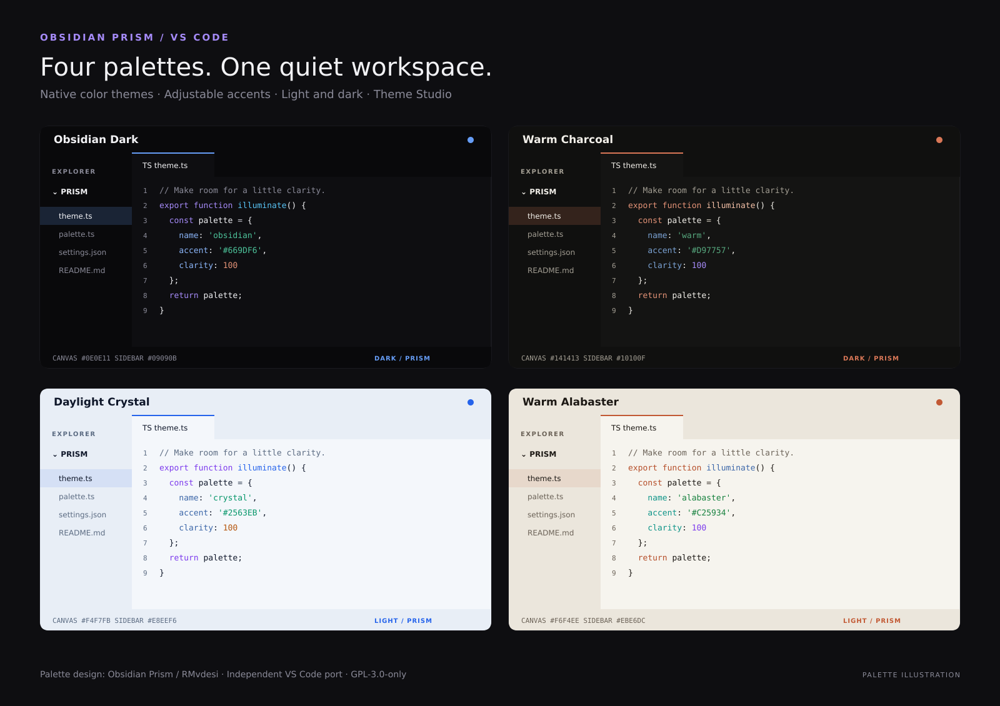

# Obsidian Prism for Antigravity & VS Code

[中文](README.md) · [Antigravity compatibility](docs/ANTIGRAVITY.md) · [Porting scope](docs/PORTING.md) · [Implementation plan](docs/PLAN.md) · [Tracking issue #2](https://github.com/bahayonghang/obsidian-prism-vscode-theme/issues/2)

An independent adaptation of the four palettes and appearance controls from [Obsidian Prism by RMvdesi](https://github.com/RMvdesi/obsidian-prism), designed primarily for **Antigravity IDE** and compatible with standard VS Code. It provides conversation-sidebar, editor, workbench, terminal and syntax colors with a Chinese/English Theme Studio.

**0.3.0 adds optional styling inside the real Antigravity chat.** Explicitly enable the desktop adapter to add aurora/texture backgrounds, composer surfaces, model pills and menu styling on verified installations. Native Settings descriptions and options are bilingual, and the extension UI language can be selected independently. See [architecture, limits and recovery](docs/CHAT_APPEARANCE.md) and the earlier [native color evidence](docs/ANTIGRAVITY.md).

**This is an unofficial modified distribution, not an official RMvdesi release and not affiliated with or endorsed by RMvdesi, Microsoft or Google.** Original copyright belongs to RMvdesi and upstream contributors. Licensed under GPL-3.0-only. Modification dates: 2026-11-21 and 2026-11-22. See [UPSTREAM.md](UPSTREAM.md), [LICENSE](LICENSE), [NOTICE](NOTICE) and [THIRD_PARTY_NOTICES.md](THIRD_PARTY_NOTICES.md).



This is a palette/layout illustration, not a captured VS Code screenshot. [Vector version](media/preview.svg)

## Install

Use **Antigravity IDE**, or **VS Code 1.96.0 or later**. This project is not published to the Marketplace. Build an installable package from source:

```bash
git clone https://github.com/bahayonghang/obsidian-prism-vscode-theme.git
cd obsidian-prism-vscode-theme
npm ci
npm test
npm run package
code --install-extension artifacts/obsidian-prism-vscode-theme-0.3.0.vsix
```

In **Antigravity IDE's Extensions view** (or VS Code), select **… → Install from VSIX…** and open the generated file. The `code` command above installs only into VS Code; use Antigravity's own Extensions view for that host. Then:

1. Run **Preferences: Color Theme** and select an `Obsidian Prism — …` theme.
2. Run **Obsidian Prism: Open Theme Studio** and choose layered, unified or accent-tinted sidebar surfaces. Preview the conversation color schematic, then apply.
3. Configure accent, contrast and syntax styling. Use **Show Antigravity Compatibility Report** to distinguish the IDE product version from its VS Code base version.
4. Apply optional typography and system appearance settings separately when wanted.

Installation does not automatically select a theme. All four static color themes work without activating extension code; the companion runtime provides customization. Desktop and browser entries are included. Browser extension sideloading is a separate workflow from desktop VSIX installation; see [porting notes](docs/PORTING.md#兼容性与构建).

## Optional real-chat styling

Apply a Prism theme, open Theme Studio, and find **Real conversation appearance**. Choose background, intensity, composer and model-pill styles, then click **Enable chat appearance…**. Review the installation path and backup notice. **Fully quit all Antigravity windows and reopen the application** afterward; Reload Window is not sufficient.

This optional feature changes one verified startup file and keeps its exact original. Unknown builds, external file changes, browser/remote hosts and unwritable installations are not patched. Application updates can require a new compatibility check. Use **Apply chat preferences** to update an enabled adapter, and **Disable & restore** before disabling or uninstalling the extension. Disabling the extension in the Extensions view does not undo an already installed application hook. Each window follows its own Prism palette and non-Prism windows remain unstyled. Advanced material preferences are shared by the installation. See [architecture, support and recovery](docs/CHAT_APPEARANCE.md).

## Extension language

The language selector at the top of Theme Studio saves immediately for the Studio, extension dialogs and reports, without applying other draft changes. **Choose Extension Language / 选择扩展语言** is also in the command palette.

Native Settings descriptions and dropdown labels stay bilingual. Headings such as `Chat Background` are generated by the IDE from stable configuration IDs and cannot independently follow the extension language. This does not change the IDE display language. Existing saved values and settings exports remain compatible.

## Themes

| Theme | Appearance | Sidebar | Editor |
| --- | --- | --- | --- |
| Obsidian Prism — Obsidian Dark | Cool dark slate | `#09090B` | `#0E0E11` |
| Obsidian Prism — Warm Charcoal | Warm charcoal with orange accents | `#10100F` | `#141413` |
| Obsidian Prism — Daylight Crystal | Cool, bright blue-gray | `#E8EEF6` | `#F4F7FB` |
| Obsidian Prism — Warm Alabaster | Warm paper-like light palette | `#EBE6DC` | `#F6F4EE` |

Base colors are taken from the pinned upstream `style.css`. VS Code UI, TextMate and semantic-token mappings are adaptations developed for this project.

## Appearance controls and their scope

| Control | Options | Scope |
| --- | --- | --- |
| Accent | Default, Cobalt, Iris, Amber, Graphite Monochrome, custom hex | Native Prism themes |
| Contrast | Standard / High | Native Prism palettes; this is not a replacement for VS Code high-contrast themes |
| Sidebar & conversation surface | Layered / Unified / Tinted | Shared native sidebar, Explorer and Activity Bar colors; not a chat-only override |
| Native input outline | Subtle / Accent | Ordinary native inputs; **does not control the Antigravity composer**, whose frame is derived by its client |
| Syntax | Italic comments / bold keywords | Native Prism themes |
| Corners | Sharp / Balanced / Soft | **Theme Studio only** |
| Ambient glow | 0 / 35 / 70 / 100 | **Theme Studio only** |
| Motion | Off / Subtle / Standard / Ultra | **Theme Studio only**, respecting reduced-motion preferences |
| Extension language | Follow editor / Chinese / English | Studio, dialogs and reports; native descriptions/options remain bilingual |
| Real chat background | None / Aurora / Aurora & texture | Actual conversation after explicitly enabling the adapter |
| Chat background intensity | 0 / 35 / 70 / 100 | Decorative background only |
| Chat composer / model pill & menu | Native / Prism | Actual chat surfaces, with native interaction retained |
| Chat motion | Off / Subtle | Adapter background only; respects reduced motion |
| Font | Default (keep/restore previous), JetBrains Mono, Cascadia Code, SF Mono | User-level editor settings, explicitly applied |
| Ligatures, smooth caret, smooth scrolling | Inherit / On / Off | Explicitly applied with typography; restorable |
| Follow system appearance | A preferred dark/light theme pair | Native VS Code automatic appearance; explicitly applied and restorable |
| Import / export | Validated extension settings JSON | Only this extension's allowed settings |

Fonts must be installed separately; no fonts are downloaded. Theme color customizations use exact Prism theme scopes, so switching to a different theme stops them from applying. **Typography and system appearance are user settings**: they affect other themes and remain after disabling or uninstalling the extension until restored.

Custom accents use `#RRGGBB`, for example `#A58AF8`. When applying typography, Default/Inherit leaves unmanaged values alone or restores values previously replaced by this extension.

### Restore and uninstall

If the real-chat adapter was enabled, run **Disable Chat Appearance and Restore** before uninstalling and fully restart Antigravity. Restore verifies the original backup and current owned modification; external edits are preserved. The backup directory includes a standalone recovery script. See [recovery details](docs/CHAT_APPEARANCE.md).

- **Reset Customizations / Reset Prism** is a full reset: it clears Prism preferences and restores owned color, typography and system-appearance settings and disables an owned chat adapter, preserving unrelated entries. Use the specific commands below when only typography or system appearance needs restoring.
- If typography or system appearance was applied, run **Restore Typography** and **Restore System Appearance** before uninstalling.
- Restoration changes only values that still match what the extension last wrote. Subsequent manual edits are preserved.
- Failed apply/restore actions report the error and retain restoration records. After resolving the reported settings-write problem, run the same action again.
- Theme-specific settings can remain after uninstall; they match only Prism themes. Run reset before uninstall, or inspect the clearly named Prism blocks in user `settings.json` afterward.
- Workspace, language-specific and other extension settings may override user settings. Check VS Code's native settings inspector if an option appears ineffective.

## Commands

Commands use the `Obsidian Prism` prefix. Stable command IDs:

| ID | Action |
| --- | --- |
| `obsidianPrism.openSettings` | Open Theme Studio |
| `obsidianPrism.chooseTheme` | Choose a theme |
| `obsidianPrism.chooseLanguage` | Choose and immediately save the extension language |
| `obsidianPrism.enableChatAppearance` | Explicitly verify, back up and install the chat adapter |
| `obsidianPrism.updateChatAppearance` | Refresh an already owned chat stylesheet |
| `obsidianPrism.disableChatAppearance` | Remove chat styling and restore the owned startup file |
| `obsidianPrism.openNativeSettings` | Open native VS Code settings |
| `obsidianPrism.showCompatibilityReport` | Read-only host versions, color path and compatibility boundaries |
| `obsidianPrism.resetCustomizations` | Reset all Prism preferences and owned appearance settings |
| `obsidianPrism.exportSettings` / `obsidianPrism.importSettings` | Export / import extension settings |
| `obsidianPrism.applyTypography` / `obsidianPrism.restoreTypography` | Apply / restore typography and editor motion |
| `obsidianPrism.applySystemAppearance` / `obsidianPrism.restoreSystemAppearance` | Apply / restore automatic system appearance |

## Scope and development

Antigravity **IDE**, the standalone **App**, and Google's **VS Code extension** are separate products. The upstream App installation process does not apply to this VSIX. The inspected modern client derives composer cards from sidebar colors; legacy IDE 1.23.2 mixes editor background with fixed gray. Neither inspected composer consumes `input.border`. The native input outline setting is therefore explicitly separate from Antigravity chat.

The conversation preview is a **color schematic**, not a captured user session. It models the inspected modern client at default internal contrast. Host appearance preferences, other color overrides and future client versions can change the result. This theme reads no conversations, credentials or model state.

VS Code's supported extension API does not expose the workbench DOM or arbitrary CSS. Whole-window blur, custom shell geometry and global spring animations are therefore not advertised as native-theme features. The original corner, ambient-light and motion settings remain confined to Theme Studio. Version 0.3.0 adds five separate chat appearance preferences and an explicitly enabled local application-file adapter; it is not a supported native theme API. See the [feature mapping](docs/PORTING.md).

Quota telemetry, thought translation, model controls, chat management, mascots, the embedded browser and file viewer are excluded. The optional adapter changes one verified startup file and loads a fixed, scoped stylesheet through Electron frame APIs. It makes no network requests, opens no debugging port and launches no background service. It does not read conversation content, credentials or model state.

Use Node.js 22 LTS or a newer supported release. `npm test` and `npm run package` are the verification and packaging entry points. Open the repository in VS Code and press F5 for an Extension Development Host. Check all palettes, both panel languages, keyboard navigation, narrow layouts, import/export, and apply/restore behavior with existing manual settings. Packaging does not publish the extension; publishing requires the maintainer's publisher registration and credentials.

CI also uses official, SHA-256-pinned **Antigravity IDE 1.23.2 and 2.8.0** executables with isolated profiles to verify theme APIs, settings, restoration and reports. The legacy version runs with three fresh profiles; any failure fails the job. Launch flags request disabled Agent extensions, but the legacy IDE can still start its built-in service. Tests do not sign in or send conversations, so this is not an authenticated chat screenshot test. `python3 scripts/prepare-antigravity.py --version 2.8.0` repeats the distribution color-contract checks and writes `artifacts/antigravity-source-2.8.0.json`. It downloads into an ignored test cache without installing or modifying your normal IDE.

Current verification is recorded in [appearance issue #3](https://github.com/bahayonghang/obsidian-prism-vscode-theme/issues/3) and [language issue #4](https://github.com/bahayonghang/obsidian-prism-vscode-theme/issues/4). Native color history is recorded in [issue #2](https://github.com/bahayonghang/obsidian-prism-vscode-theme/issues/2); initial port history is in [issue #1](https://github.com/bahayonghang/obsidian-prism-vscode-theme/issues/1). Host tests that have not run must not be described as passed.
