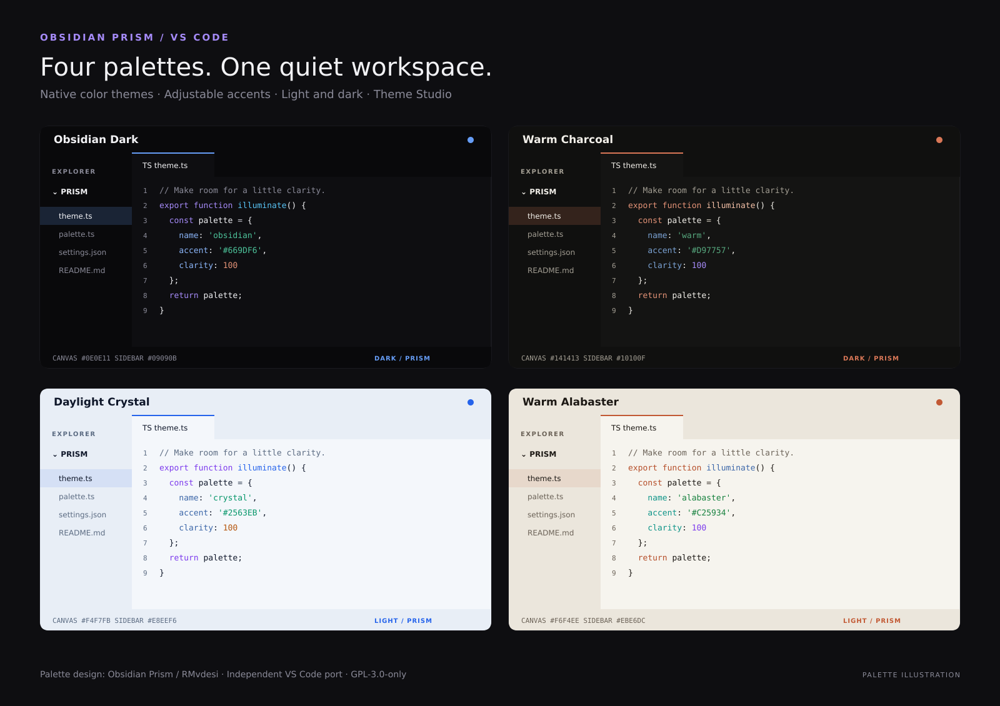

# Obsidian Prism for Antigravity & VS Code

[English](README.en.md) · [真实对话外观](docs/CHAT_APPEARANCE.md) · [原生颜色适配](docs/ANTIGRAVITY.md) · [移植范围](docs/PORTING.md) · [实施规划](docs/PLAN.md)

将 [RMvdesi / Obsidian Prism](https://github.com/RMvdesi/obsidian-prism) 的四套配色和外观设置带到 **Antigravity IDE**，同时兼容标准 VS Code。这个独立移植版只包含主题相关功能：对话侧栏、编辑器、终端、语法配色，以及中英文 Theme Studio 设置面板。

**0.3.0 增加真实对话区的可选外观适配层。** 在已验证的桌面版 Antigravity 中，显式启用后可以添加极光与纹理背景、优化输入框、模型选择胶囊和弹出菜单。原生设置说明与选项同时提供中英文；工作室、弹窗和报告可独立切换语言。普通原生主题继续单独可用。实现方式、版本范围与恢复流程见 [真实对话外观说明](docs/CHAT_APPEARANCE.md)。

**这是基于上游的非官方修改版，与 RMvdesi、Microsoft 或 Google 没有隶属或背书关系。** 原项目版权归 RMvdesi 及其上游贡献者所有；本项目采用 GPL-3.0-only。修改日期：2026-11-21 / 2026-11-22。来源、修改说明及完整声明见 [UPSTREAM.md](UPSTREAM.md)、[LICENSE](LICENSE)、[NOTICE](NOTICE) 和 [THIRD_PARTY_NOTICES.md](THIRD_PARTY_NOTICES.md)。



上图为配色与布局示意，不是真实 VS Code 截图。[矢量版本](media/preview.svg)

## 安装与开始使用

使用 **Antigravity IDE**，或 **VS Code 1.96.0 或以上**。本项目尚未发布到 Marketplace，可以从源码构建 VSIX：

```bash
git clone https://github.com/bahayonghang/obsidian-prism-vscode-theme.git
cd obsidian-prism-vscode-theme
npm ci
npm test
npm run package
code --install-extension artifacts/obsidian-prism-vscode-theme-0.3.0.vsix
```

在 **Antigravity 的扩展页面**（或 VS Code）打开 `…` 菜单，选择 **Install from VSIX… / 从 VSIX 安装…**，打开上述文件。上面的 `code` 命令只安装到 VS Code；Antigravity 请使用自己的扩展页面。安装完成后：

1. 打开命令面板，执行 **Preferences: Color Theme**，选择任意一个 `Obsidian Prism — …` 主题。
2. 执行 **Obsidian Prism: Open Theme Studio**，在“Antigravity 与侧栏”中选择底色：原始分层、与编辑区一致、淡强调色。先看对话配色示意，再点击应用。
3. 调整强调色、对比度和代码样式。宿主信息卡可打开 **Show Antigravity Compatibility Report**，区分 IDE 产品版本与 VS Code 基础版本。
4. 字体和跟随系统明暗模式各有单独的应用、恢复按钮，需要时再使用。

安装本身不会替你切换主题。四个静态主题不依赖设置面板或扩展代码激活；设置面板及动态自定义由扩展运行时提供。项目包含桌面和浏览器运行入口；浏览器宿主的侧载方式与桌面 VSIX 安装不同，见 [移植说明](docs/PORTING.md#兼容性与构建)。

### 开启真实聊天背景、输入框和模型胶囊

1. 先应用一套 Prism 配色，打开 Theme Studio 的 **真实对话区外观**。
2. 选择背景、强度，以及输入框和模型菜单的 `Prism` 样式。
3. 点击 **启用对话外观…**，查看具体安装路径与备份说明并确认。只有这一步会安装适配层。
4. **完全退出所有 Antigravity 窗口并重新打开应用**；“重新加载窗口”不能替代完整重启。
5. 此后点击 **应用对话偏好** 或修改已保存的设置，可以更新样式。切换到非 Prism 主题时，适配层移除自己的样式。

适配层需要修改经过指纹验证的 Antigravity 启动文件，并保留原文件备份。未验证的版本、外部改动、只读安装目录、浏览器或远程宿主会阻止安装；不会自动提权或强行覆盖。更新软件后可能需要重新检查兼容性。禁用或卸载扩展前使用 **停用并恢复**；扩展管理页的“禁用”不会自动撤销已安装的启动钩子。不同窗口按自己的 Prism 配色显示，非 Prism 窗口保持原状；背景、强度等高级偏好仍由同一安装共用。完整限制与手动恢复方式见 [说明](docs/CHAT_APPEARANCE.md)。

### 选择插件语言

工作室最上方的 **扩展语言** 支持“跟随编辑器 / 简体中文 / English”，选择后立即保存，不会顺便应用其他主题草稿。命令面板也可搜索 **Choose Extension Language / 选择扩展语言**。

原生 Settings 页的说明和下拉选项始终显示中英双语，例如 `Aurora & texture / 极光与纹理`。`Language`、`Chat Background` 等行标题由 IDE 根据配置键生成，不能用插件语言选项单独翻译。此选项也不会改变整个 Antigravity 的显示语言。

## 四套主题

| VS Code 中的名称 | 观感 | 侧栏 | 编辑区 |
| --- | --- | --- | --- |
| Obsidian Prism — Obsidian Dark | 冷色黑曜石深色 | `#09090B` | `#0E0E11` |
| Obsidian Prism — Warm Charcoal | 暖灰深色，橙色点缀 | `#10100F` | `#141413` |
| Obsidian Prism — Daylight Crystal | 清亮的蓝灰浅色 | `#E8EEF6` | `#F4F7FB` |
| Obsidian Prism — Warm Alabaster | 暖纸白浅色 | `#EBE6DC` | `#F6F4EE` |

基础色取自固定版本的上游 `style.css`；VS Code 的语法、语义 token 与界面颜色映射由本项目补充，不是直接把原 CSS 注入编辑器。

## 设置能改变哪里？

| 设置 | 选项 | 生效范围 |
| --- | --- | --- |
| 强调色 | 默认、Cobalt、Iris、Amber、石墨单色、自定义十六进制颜色 | 四套 Prism 主题的原生界面 |
| 对比度 | 标准、高 | Prism 主题；“高”是本项目配色选项，不是 VS Code 系统高对比主题 |
| 侧栏与对话底色 | 原始分层、与编辑区一致、淡强调色 | Antigravity 对话背景、资源管理器与活动栏共用的原生颜色；不是仅聊天区域的覆盖 |
| 原生输入边框 | 柔和、强调色 | 普通原生输入控件；**不控制 Antigravity 聊天输入框**，后者由宿主自行生成 |
| 代码样式 | 斜体注释、加粗关键字 | Prism 主题的代码配色 |
| 圆角 | Sharp / Balanced / Soft | **仅 Theme Studio 面板** |
| 环境光 | 0 / 35 / 70 / 100 | **仅 Theme Studio 面板** |
| 动效 | Off / Subtle / Standard / Ultra | **仅 Theme Studio 面板**，遵循减少动态效果偏好 |
| 扩展语言 | 自动跟随编辑器、中文、English | Theme Studio、扩展弹窗与报告；原生说明和选项始终双语 |
| 真实对话背景 | 无、极光、极光与纹理 | 显式启用适配层后，实际 Antigravity 欢迎/对话区 |
| 真实背景强度 | 0 / 35 / 70 / 100 | 仅上述背景，不影响文字透明度 |
| 真实输入框 | 原生 / Prism | 显式启用后，实际输入框的表面、圆角、边框和阴影 |
| 模型胶囊与菜单 | 原生 / Prism | 显式启用后，实际模型按钮及弹出菜单的外观 |
| 对话区动效 | 关闭 / 轻微 | 仅适配层背景，遵循减少动态效果偏好 |
| 字体 | Default（保持/恢复原设置）、JetBrains Mono、Cascadia Code、SF Mono | 显式应用后，修改 VS Code 用户级编辑器设置 |
| 连字、平滑光标、平滑滚动 | 保持原设置 / 开 / 关 | 与字体一起显式应用，可恢复 |
| 跟随系统明暗 | 选择深色、浅色主题组合后应用 | VS Code 原生的自动明暗模式，可恢复 |
| 导入 / 导出 | 本扩展的设置 JSON | 校验允许的字段和值；不导入任意 VS Code 设置 |

字体需要自行安装；扩展只配置字体栈，不下载字体。Prism 的配色通过各主题名称限定作用范围，切换到其他主题后不会继续套用 Prism 配色。字体与系统明暗选项是 VS Code **用户级设置**，会继续影响其他主题，禁用或卸载扩展也不会自动恢复。

自定义颜色使用 `#RRGGBB` 格式，例如 `#A58AF8`。在应用字体选项时，`Default` 或 `Inherit` 会保留未受管理的原值，或恢复此前由本扩展替换的值。

### 恢复与卸载

- 使用过真实对话外观时，先执行 **Disable Chat Appearance and Restore / 停用对话外观并恢复**，再完全重启 Antigravity。原始启动文件只有在备份和当前改动均匹配时才会恢复；不会覆盖其他工具的改动。
- **Reset Customizations / Reset Prism** 是完整重置：清除本扩展的偏好，并恢复仍由本扩展管理的配色、字体及系统明暗设置，同时停用已安装的对话适配层；它不会把整个 `settings.json` 清空。只需恢复字体或系统明暗时，使用下列对应命令。
- 如使用过字体或系统明暗应用按钮，先分别执行 **Restore Typography**、**Restore System Appearance**，再卸载。
- 恢复只处理仍等于本扩展上次写入值的设置。你之后手工改动的值会保留。
- 应用或恢复失败时会报告错误，并保留恢复记录；解决提示中的设置写入问题后，可以再次执行相同操作。
- 主题专属自定义可能在卸载后留在用户设置中；它们只匹配上述 Prism 主题，不影响其他主题。需要清理时，在卸载前执行恢复命令；已卸载时也可在用户 `settings.json` 中检查这些明确命名的块。
- 工作区、语言专属设置或其他扩展可能优先覆盖用户设置；若某项看起来没生效，请检查 VS Code 原生设置中的覆盖来源。

## 命令

所有命令均在命令面板中以 `Obsidian Prism` 为前缀，可通过以下稳定 ID 绑定快捷键：

| ID | 用途 |
| --- | --- |
| `obsidianPrism.openSettings` | 打开 Theme Studio |
| `obsidianPrism.chooseTheme` | 选择四套主题 |
| `obsidianPrism.chooseLanguage` | 单独选择并立即保存扩展语言 |
| `obsidianPrism.enableChatAppearance` | 验证、备份并显式启用真实对话样式，之后完整重启 |
| `obsidianPrism.updateChatAppearance` | 更新已启用的对话样式，不安装适配层 |
| `obsidianPrism.disableChatAppearance` | 停用对话样式并恢复拥有明确归属的启动文件 |
| `obsidianPrism.openNativeSettings` | 打开 VS Code 原生设置 |
| `obsidianPrism.showCompatibilityReport` | 查看只读 Antigravity 版本、颜色路径与适配范围报告 |
| `obsidianPrism.resetCustomizations` | 重置全部 Prism 偏好及仍受管理的外观设置 |
| `obsidianPrism.exportSettings` / `obsidianPrism.importSettings` | 导出 / 导入设置 |
| `obsidianPrism.applyTypography` / `obsidianPrism.restoreTypography` | 应用 / 恢复编辑器字体与动态设置 |
| `obsidianPrism.applySystemAppearance` / `obsidianPrism.restoreSystemAppearance` | 应用 / 恢复系统明暗跟随 |

## 移植边界

Antigravity **IDE**、独立 **App** 与 Google 的 **VS Code 扩展**是不同产品。上游针对 App 的安装方式不适用于这个 VSIX。已检查的新版 Google 前端从侧栏颜色生成聊天卡片；旧版 IDE 1.23.2 的输入背景则由编辑区颜色混合固定灰色生成。两者的聊天输入框都不直接使用 `input.border`，所以本项目不会把普通输入控件的边框选项宣传成聊天输入框控制。

对话预览是根据检查过的客户端颜色公式绘制的**配色示意**，不是用户会话截图。它模拟新版的默认内部对比度；宿主自己的外观设置、其他主题覆盖或后续版本可改变实际结果。主题插件不读取聊天内容、凭据或模型状态。

VS Code 的标准扩展 API 可以改变颜色和代码样式，但不提供任意工作台 CSS 接口。0.3.0 的真实对话样式因此使用**独立、可选的本地安装文件适配层**，并非官方主题 API。它仅处理已识别的聊天区域，不提供全窗口玻璃、布局重排或原版全部动画。旧的圆角、环境光和动效设置仍只作用于 Theme Studio；实际聊天使用独立的五项设置。详见 [可行性分析](docs/CHAT_APPEARANCE.md)。

本扩展不包含上游的额度统计、思维翻译、模型控制、聊天管理、宠物、内置浏览器或文件查看器。可选适配层只加载固定的外观样式，不启用调试端口、不创建后台服务、不发起网络请求，不读取对话文本、凭据或模型状态。

## 开发与验证

建议使用 Node.js 22 LTS 或更新的受支持版本。

```bash
npm ci
npm test
npm run package
```

在 VS Code 中打开仓库并按 F5，可以启动独立的 Extension Development Host 检查主题和面板。应重点检查：四套主题、中文与英文、窄窗口、键盘操作、导入导出、主题切换，以及修改已有设置后的应用与恢复。构建命令不等于 Marketplace 发布；发布需要维护者自己的 publisher 和发布权限。

CI 除标准 VS Code 外，还会从官方固定版本包启动 **Antigravity IDE 1.23.2 / 2.8.0** 的隔离扩展宿主，验证主题设置、恢复与报告。旧版用三个全新配置重复检查，任何一次失败都会使任务失败。启动参数请求禁用 Agent 扩展，但旧版仍可能启动内置服务；测试不会登录或发送对话，因此不等同于聊天界面的截图验收。可复现的发行包颜色检查：

```bash
python3 scripts/prepare-antigravity.py --version 2.8.0
```

该开发脚本只把校验过 SHA-256 的官方包放进忽略的测试目录，不安装或修改你正在使用的 IDE。结果写入 `artifacts/antigravity-source-2.8.0.json`。

本轮规划与验证记录见 [真实对话外观 #3](https://github.com/bahayonghang/obsidian-prism-vscode-theme/issues/3) 和 [设置语言 #4](https://github.com/bahayonghang/obsidian-prism-vscode-theme/issues/4)。原生适配历史见 [#2](https://github.com/bahayonghang/obsidian-prism-vscode-theme/issues/2)，初版见 [#1](https://github.com/bahayonghang/obsidian-prism-vscode-theme/issues/1)。文档不把未执行的宿主测试写成已通过。
