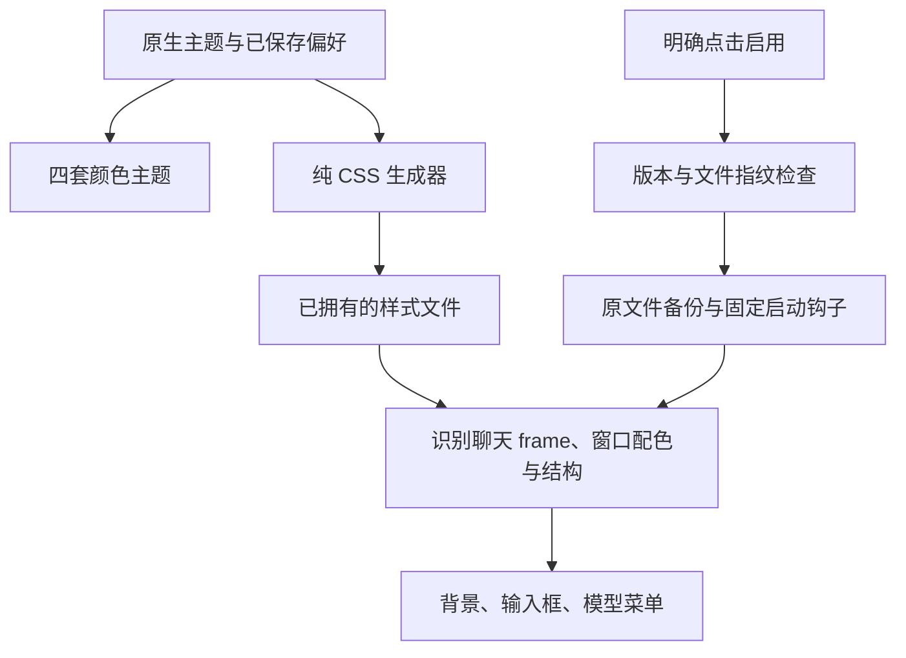

# 真实 Antigravity 对话外观与设置语言

版本：0.3.0。调研与修改日期：2026-11-22（America/New_York）。

任务：[外观 issue #3](https://github.com/bahayonghang/obsidian-prism-vscode-theme/issues/3)、[语言 issue #4](https://github.com/bahayonghang/obsidian-prism-vscode-theme/issues/4)。此前的原生颜色映射见 [ANTIGRAVITY.md](ANTIGRAVITY.md)。

## 结论

**可以添加背景、优化输入框和模型胶囊，但需要额外的本地外观适配层。** 普通主题文件负责颜色；极光背景、纹理、圆角、阴影和菜单表面需要 CSS。两者各自独立：未开启适配层时仍可使用四套原生主题。

**可以让插件自身使用中文或英文，并让原生设置说明和选项始终双语。** 原生 Settings 行标题由 IDE 从配置键生成，不能通过 `obsidianPrism.language` 单独改成另一种语言。语言开关不会改动整个 IDE 的显示语言，也不会顺便应用未保存的主题草稿。

## 为什么 0.2.0 只有颜色变化？

旧版 IDE 1.23.2 的聊天区域直接位于工作台内。新版 IDE 2.8.0 的 Google 扩展先建立外层 Webview，再嵌入一个不同来源的本地聊天 iframe。模型菜单还会通过 portal 放到聊天文档的另一处。

因此有三个不同的边界：

| 位置 | 普通主题可控制 | 额外 CSS 的要求 |
| --- | --- | --- |
| 工作台、侧栏、工具栏 | VS Code 注册的颜色键 | 不应因聊天定制重排整个工作台 |
| 真实聊天 iframe | Google bridge 转发并消费的颜色 | 仅改外层 Webview 或工作台 CSS 无法穿过 iframe |
| 模型弹出菜单 | 客户端生成的语义颜色 | 菜单不一定是输入框的后代，必须在同一聊天文档内精确定位 |

现代客户端按侧栏颜色派生输入框，旧版按编辑区颜色混合固定灰色。`input.border` 不是这两个聊天输入框的独立控制入口。0.2.0 已实现可用的原生颜色路径；本轮增加之前没有的、独立可选的样式路径。

参考：[VS Code 颜色主题](https://code.visualstudio.com/api/extension-guides/color-theme)、[扩展能力限制](https://code.visualstudio.com/api/extension-capabilities/overview#restrictions)。

## 调研过但未采用的路径

| 路径 | 调研结果 | 决定 |
| --- | --- | --- |
| 标准主题 JSON | 仅提供已注册的色值；不能表达任意背景纹理、圆角和阴影 | 保留作为默认功能 |
| `workbench.colorCustomizations` / `chat.*` | 不能据名称推断 Antigravity 一定消费该键 | 只使用已核实的消费映射 |
| 在外层 bridge 中追加 CSS | 新版聊天内容在不同来源的 iframe 内 | 不把外层改色冒充真实聊天定制 |
| 原生 plugin theme / wallpaper | 前端存在 `plugin-theme-home-wallpaper`，但当前主题通道受内部 cohort / 宿主开关限制 | 不启用内部开关、不假冒权限、不注册未公开的主题接口 |
| 修改前端压缩资源或本地服务响应 | 更新易失效，并把主题与应用内容分发耦合 | 不拦截请求、不代理本地服务 |
| 调试端口 / CDP 注入 | 增加与外观无关的调试入口 | 不采用 |
| 本地受控启动适配层 | 能利用应用自身 Electron frame API，在特定聊天文档加入固定样式 | 显式启用、核对指纹、保留备份、可恢复 |

Google 公共插件组件说明见 [Antigravity Plugins](https://antigravity.google/docs/ide-plugins?app=antigravity-ide)。具体内部通道的判断来自本地检查的官方资源，不把“文件中出现一个名称”当作用户有权使用的 API。

## 实现结构

桌面入口使用 Node 文件操作处理本地备份与恢复；浏览器入口只包含原生主题和工作室。浏览器、远程宿主和普通 VS Code 不安装该适配层。共享的设置逻辑不会导入桌面文件操作模块。

启动适配层使用 Electron 的 [`webFrameMain`](https://www.electronjs.org/docs/latest/api/web-frame-main) 和 [`webContents`](https://www.electronjs.org/docs/latest/api/web-contents) 接口，在识别出的 frame 中创建一个固定 ID 的样式节点与一个 Prism 标记。它不更改 Google bridge、模型调用、账户和安全策略。

官方 CLI 1.5.14 的前端服务器二进制中，已定位 `Content-Security-Policy` 的实际构造与响应头赋值：策略仅含 `frame-ancestors` 与 `report-uri`，没有 `style-src` 或 `default-src` 限制；同包的聊天 `index.html` 也没有额外 CSP meta，并使用内联脚本与样式。因此已检查发行包具备添加本地样式的条件。这里依据的是官方资源静态证据，未声称观察过已登录会话的 HTTP 响应。若实际页面或未来版本拒绝内联样式，loader 会检查计算样式、移除自身节点和标记，并报告 `csp-blocked`，不会放宽策略。包哈希、指令位置及限制见 [CSP 证据](chat-appearance-evidence.json)。

新版 frame 必须匹配本地来源与官方 iframe 参数，例如 `extensionView=true`、`extensionVariant=vs-code`、`hostVariant=antigravity-ide` 和 `platform=electron`，并具备核实过的聊天结构。旧版必须匹配工作台来源及旧聊天侧栏结构。不会记录包含工作区参数的完整 URL，也不读取聊天文本。

## 具体改变什么？

| 用户看到的区域 | Prism 外观 | 保留的宿主行为 |
| --- | --- | --- |
| 欢迎与对话背景 | 多层低位极光渐变、可选细纹理、强度选择 | 原有欢迎文字、消息、滚动与空状态 |
| 输入框 | 分层表面、细边框、柔和阴影、明确焦点 | 输入内容、占位符、附件、发送/停止、原生图标 |
| 模型胶囊 | 圆润表面、边框、悬停与展开状态 | 当前模型名称、禁用状态、原生点击和提示 |
| 模型菜单 | 深浅主题对应的表面、边界与选中/悬停反馈 | 原生位置、碰撞避让、最大高度、滚动、键盘导航、子菜单 |

背景由独立 CSS 生成，不复制原项目 Canvas/WebGL 或基于 Agent 状态变化的控制器。截图里的额度面板、会话统计、模型管理等功能不在实现范围内。

所有四套配色都参与生成；自定义强调色先经过六位十六进制校验。高对比偏好会削弱装饰并加强边界；系统减少动态效果偏好优先。默认关闭背景动效，避免让长时间阅读的对话页面持续晃动。

### 已核实的选择器

现代聊天：

- `.agy-home` 与 `[data-testid="conversation-view"]`。
- `#antigravity\.agentSidePanelInputBox.surface-composer`、`.surface-composer-card`。
- `[data-testid="model-selector-trigger"]`。
- `.agy-overlay:has([data-testid="model-selector-panel"])` 及原生 model-selector 行。

旧版聊天：

- `.antigravity-agent-side-panel` 与其 conversation-view。
- `#antigravity\.agentSidePanelInputBox` 的原生输入表面。
- 经源码核实的模型按钮标记与菜单特征。

CSS 同时要求 `html[data-prism-host-appearance]` 和 `data-prism-host-palette` 两个明确标记。模型菜单单独处理 portal；不会通过泛用 `button` / `dialog` 规则改变其他面板。

### 多窗口隔离

扩展通过公开的 `contributes.colors` 注册 `obsidianPrism.themeMarker`。四套 Prism 主题分别提供固定身份色；其他主题默认透明。这不是可见界面的色块。

旧版工作台把已注册主题变量放在 `.monaco-workbench`；新版外层 Webview 的主题提供器转发全部已注册颜色，将变量放在内容文档根元素。适配层读取该窗口的这一个计算色值，选择样式包中的对应配色。Google 内层 bridge 无需识别或转发该自定义颜色。

缺失、透明或未知标记会移除该 frame 的自有样式。轻量检查约每秒检测主题标记变化；未改变的窗口保留同一个样式节点。此路径避免一个非 Prism 窗口清空其他窗口的样式，也避免 Prism 窗口给其他主题套色。

参考：[公开颜色贡献](https://code.visualstudio.com/api/references/contribution-points#contributes.colors)、[Webview 主题变量](https://code.visualstudio.com/api/extension-guides/webview#theming-webview-content)。

## 开启、更新和恢复

1. 安装 0.3.0 VSIX，应用任意一套 Prism 主题。
2. 打开 Theme Studio → **真实对话区外观**。
3. 设置背景、强度、输入框、模型胶囊与动效。
4. 点击 **启用对话外观…**，检查当前安装路径，确认备份与完整重启要求。
5. **完全退出 Antigravity 的所有窗口并重新启动应用**。窗口重载只重启渲染/扩展侧，不能保证重载主进程钩子。
6. 后续使用 **应用对话偏好**；已启用时，保存设置和切换 Prism 配色会更新自己拥有的 CSS 文件。
7. 要还原，点击 **停用并恢复**，然后完整重启。

安装目录中的 `out/obsidian-prism-desktop` 保存固定 loader、原始启动文件备份、归属记录、样式与独立恢复脚本。扩展升级后可刷新已拥有的样式；软件更新覆盖启动文件后，不会在后台擅自重新打补丁。

恢复会核对备份与当前启动文件。若其他工具修改了文件，则保留该改动并报告冲突，不用旧备份覆盖新程序。请先查看 **Show Antigravity Compatibility Report** 中的路径与原因。

正常卸载流程是先使用插件的“停用并恢复”，再卸载扩展。只在扩展管理页点击“禁用”不会删除应用启动钩子，已经加载的样式可能继续存在。loader 会检查对应扩展包是否仍存在，避免在扩展被移除后继续套用旧样式；这不等于自动从程序文件中删除启动钩子。独立恢复脚本用于扩展已移除时的恢复，仍执行同样的归属与哈希检查。

### 设置与安装权限分离

五个 `chat*` 配置只描述外观，不包含任何 `enabled`、路径、脚本或命令字段。旧版设置 JSON 仍可导入，并补齐新选项的默认值。导入、安装扩展、切换语言、切换主题都不能安装启动钩子。

应用级适配层与外观偏好由同一 Antigravity 安装共用。不同窗口分别使用自己的 Prism 配色；使用非 Prism 主题的窗口不会应用这些样式。但背景、强度、自定义强调色等偏好仍使用最后一次保存的样式包，暂不提供各 profile 同时采用不同自定义材质的隔离。

## 支持范围与更新

初始源码参考为官方 IDE **1.23.2** 与 **2.8.0**。程序版本只是第一层检查，启动文件 SHA-256 也必须命中已审计指纹；同版本被其他工具改动后同样不能直接覆盖。

| 发行包参考 | `resources/app/out/main.js` SHA-256 |
| --- | --- |
| IDE 1.23.2 Linux x64 | `353263dae8c02d06e8d596e8fb3cb22a93a33ad207cadb094458c2170d0bc73e` |
| IDE 2.8.0 Linux x64 | `2a20131586471b1c0a22a7174021904c927b3d3a5fb21cb038c42919bb2af764` |
| IDE 1.23.2 Windows x64 User | `c98cfe9d4256fda7e9f30603cdcddf45e206a4dc3181784c1508e218b6562d65` |
| IDE 2.8.0 Windows x64 User | `187c3f56c0947da78d5991cb0ab34acbf00766bbeb96d7b3781f3b4fd8bffe4d` |

官方 Windows 安装包的 URL、包哈希与提取出的文件哈希见 [证据 JSON](chat-appearance-evidence.json)。初次提取采用只读解包，没有执行安装程序。平台范围限于已审计的 Windows / Linux 构建；不修改 macOS 签名应用。

文件指纹命中不等于当前登录会话已做视觉验收。前端可能独立更新；找不到核实过的聊天结构时不猜测新选择器。未知版本保留原生主题功能，并在面板和报告中说明适配层不可用。

这不是整个 Antigravity App 的主题补丁，也不是普通 VS Code 内所有第三方聊天扩展的通用皮肤。应用级签名、安装目录写入权限与平台限制仍需由适配器检查，不能靠自动提权或关闭校验解决。

## 设置语言的准确范围

| 界面 | 语言策略 |
| --- | --- |
| Theme Studio | `auto` / `zh-CN` / `en`，选择立即保存 |
| 插件对话框与状态 | 使用插件语言；底层恢复诊断保留双语便于定位 |
| 兼容性报告 | 主要说明跟随插件语言，保留技术标识 |
| 原生 Settings 说明 | 英文 IDE 先英后中，中文 IDE 先中后英 |
| 原生下拉选项 | 可读双语标签；保存值仍是 `auroraTexture` 等稳定值 |
| 原生设置行标题 | 由 IDE 根据稳定配置键生成，不承诺随插件语言改变 |
| 整个 IDE 的显示语言 | 不修改，由 IDE 自己管理 |

Microsoft 将 `package.nls.json` 定义为 manifest 静态贡献的本地化来源，按宿主 locale 加载。配置的 `enumItemLabels` 可以提供可读标签，而设置标题由配置键生成。参考：[vscode-l10n 官方说明](https://github.com/microsoft/vscode-l10n/blob/main/README.md)、[Configuration contribution](https://code.visualstudio.com/api/references/contribution-points#contributes.configuration)。

## 验证方式

不同层面的证据分开记录：

| 验证层 | 检查内容 | 不能据此声称 |
| --- | --- | --- |
| 官方资源静态检查 | 文件指纹、frame 参数、选择器、颜色消费 | 用户机器上已经显示正确 |
| 文件适配器测试 | 备份、重复启用、更新、冲突、恢复、未知版本拒绝 | 真实聊天已经渲染 |
| 实际 Electron frame 测试 | 跨来源 iframe、固定 loader、CSS 刷新/移除、CSP 与范围限制 | 已登录 Google、已发送对话 |
| CSS 与交互夹具 | 四套材质、门户菜单、输入/选模、窄窗口、减少动态效果 | 夹具是用户会话截图 |
| 实际 IDE 扩展宿主 | 启动钩子兼容、主题/配置/语言/恢复 API | 所有 Antigravity 版本都支持 |

最终执行命令、CI、产物和提交信息记录在 issue #3 / #4。测试不登录 Google，不发送真实对话，不读取用户项目或会话数据。
